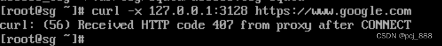

去年 4 月开了港股账户，先充了 5 万港币，后来 8 月新规生效，又补到了 10 万块。

一年下来，总共中了 9 个签，微赚2.7个w。单账户这点资金量，也没什么策略可讲，三分靠研究，七分靠选择，剩下九十分交给运气。收益都靠撞上那几支涨得好的新股。
<!-- more -->

和A股相比，港股打新不用买门票，账上有钱就能申，分配也更倾向小散户，一手中签率相对高些，有点普惠金融的感觉 :)

新的一年，继续参与，保持平常心，期待市场的馈赠。